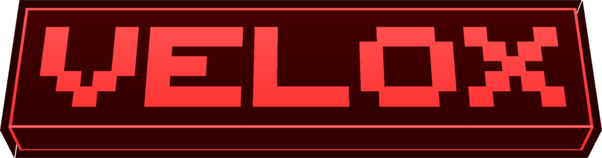

<!-- publish:only curseforge -->

<!-- /publish:only -->
<!-- publish:only modrinth -->

<!-- /publish:only -->

> **Velox is designed to offload server processing when large amounts of dropped items are present.** During large explosions, dense mob drops, or emptied containers, Velox processes item physics using batch computations to reduce tick times.

## ⚡ Key Features

- 🧺 **Batched Item Physics:** Offloads dropped item updates into grouped batches instead of executing per-entity vanilla tick loops.
- 👀 **Visual Parity:** Maintained block positions, visual rendering, and motion trajectories for on-ground items.
- 🌊 **Selective Vanilla Fallback:** Items in water, lava, hoppers, or slabs retain default Minecraft mechanics to ensure full behavior parity.
- 🖥️ **Server-side Only:** No client modifications required.

*Note: Requires [Celeris](https://github.com/bichal/Celeris) installed on the server.*

## 🏁 Benchmarks

Velox offloads item physics to batch execution. Gains depend heavily on entity density and block environment (items resting on plain solid blocks gain the most).

| Test Scenario (1.21.1) | Vanilla Tick | With Velox | Speedup |
|---|---|---|---|
| **20,000 falling items** | 493.0 ms | 28.0 ms | ~18× |
| **20,000 resting items** | 260.4 ms | 21.3 ms | ~12× |
| **8,000 resting items** | 54.9 ms | 8.7 ms | ~6× |

*Tested on dedicated NeoForge server (CI runner, median of 3 runs). Items in liquids, hoppers, or slabs retain vanilla logic and performance.*

📊 **[View complete benchmark](https://github.com/bichal/Velox/wiki/Benchmarks)**

## 📦 Requirements

- 🟩 **Minecraft:** 1.21 to 1.21.11, and 26.1 to 26.3.
- 🔶 **Loader:** NeoForge (Server-side).
- 🧩 **Dependency:** [Celeris](https://github.com/bichal/Celeris/versions/tag/v0.3.1.1) 0.3.1.1 or newer.
- ☕ **Java:** 21 for 1.21.x, 25 for 26.x.

## 📚 Learn more

The **[Velox wiki](https://github.com/bichal/Velox/wiki)** has the settings, architecture details, benchmarks, and build instructions.

<!-- bichal:license -->
## License

| Content | License |
|---|---|
| Source code | [AGPL-3.0](https://www.gnu.org/licenses/agpl-3.0.html), see [`LICENSE-AGPL`](./LICENSE-AGPL) |
| Artwork, branding and documentation | [CC BY-NC-SA 4.0](https://creativecommons.org/licenses/by-nc-sa/4.0/), see [`LICENSE-CC`](./LICENSE-CC) |

**Source code:** you may study, modify and redistribute it under the AGPL; if you run a modified version as a network service, its source must be available to that service's users.

**Artwork:** credit Bichal, no commercial use without permission, and share derivatives under the same license.

See [`LICENSE`](./LICENSE) for the full summary.
<!-- /bichal:license -->

## Credit

Velox is made by Bichal. If you use, modify, or redistribute Velox, or build on it, keep this credit and name Bichal as the original author. This requirement is an additional term under section 7 of the AGPL-3.0.

Want to use Velox in a closed-source or commercial project? Contact Bichal for a separate commercial license.

<!-- publish:on -->

---

<!-- bichal:footer -->
Code: **AGPL-3.0** · Art: **CC BY-NC-SA 4.0** · Made by **Bichal**
<!-- /bichal:footer -->
